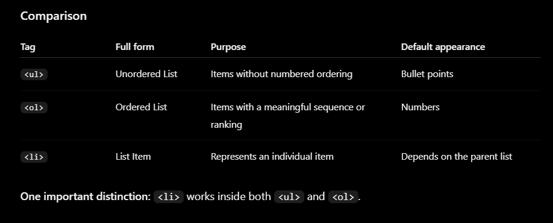
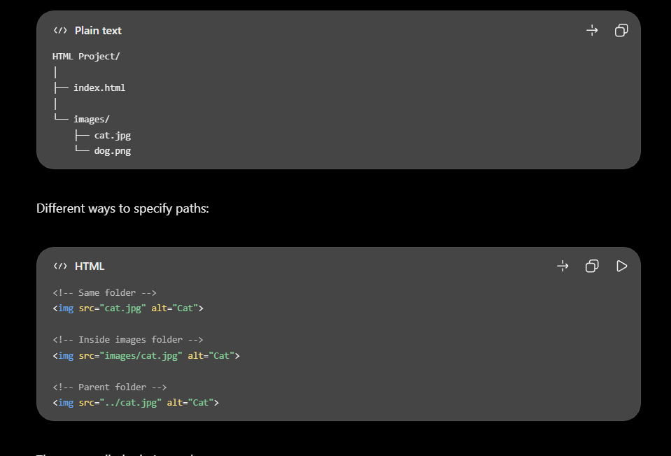
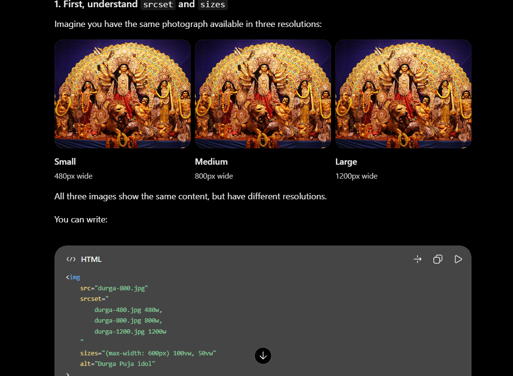
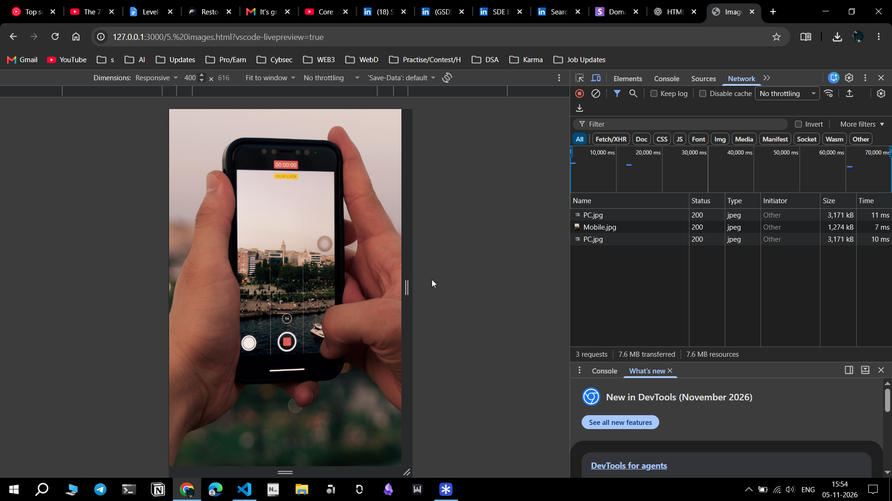
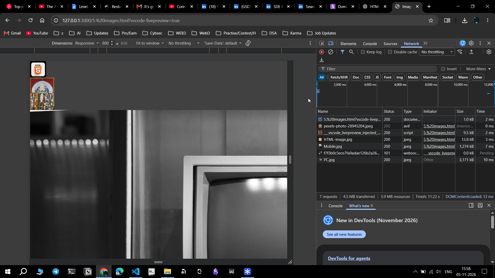

- press ! and click tab and you can get the boiler plate 
- <h1> dosen't means it is bigger than <h2>, we can use css to make <h2> bigger than <h1>. THEN WHY USE OF h TAGS?
- <h1> is heading & <h2> is sub heading. Search engines like Google easily understand this 
  

- < > This are called Tags and these are case in-sensitive meaning I can write in caps or in small. but by default we use lowercase 
   for eg:
   <HEAD>
   <head>

Tags       -> <h1>
Element    -> <h1>heading</h1>
<h1 title="heading one">heading</h1>
Attributes-> title="heading one"

# Breaking down

1. <!DOCTYPE html>
  - It tells browser which document type it is. In olds days apart from html there were xhtml, latex, xml 

2. <html lang="en">
  - Tells language 

3. HTML has 2 childs- head & body
   I can add more childs inside <head> and in <body>

4. <head> </head>
  
  - Only 2 visual parts seen in a website-
    1. Heading of a website
    2. Fevicon (small icon)

  - lot of meta tags are inside head which you want to provide about the page to server, bot  but not to be shown inside website.
   1. <meta charset="UTF-8">
     - if you want to add smiley support then use UTF-16.
   
   2. <meta name="Viewport" content="width=device-width, initial-scale=1.0">
    - this tells when this page renders what will be the zoom level, ow it will look like in mobile, pc. 
    - emmet helps here too, just write meta and add colon and u will get suggestions.   meta:

5. <body> </body>
  - Everything inside webiste is body part of html. All visual part 
  
  - We can so nesting and subnesting like we can add  inside <h2>

  1. 
    - <h2>Heading Two </h2>
    -  is an inline container used to target a small piece of text or other inline content without starting a new line.
  
      Eg:
      
I am learning HTML
             // u want to mark only word HTML red 

      we can wrap that in span:
      
I am learning HTML

  
  2. title 
    - title attribute is used to provide extra information about an HTML element, usually displayed as a tooltip when someone hovers their mouse over it.
    - if we are want to display additional info inside 
 then use <abbr>.  
         

              Learn <abbr title="HyperText Markup Language">HTML</abbr>
         

  

  3. anchor tag 
    - The anchor tag creates a hyperlink that users can click to navigate somewhere.
    - u can also use emmet. press a and add colon.    a: 
  
    <a href=" ">Click Here</a>

    - href is an attribute that specifies an destination.
    - <a> creates a link while href tells where that link should go. 

      1. **Link to another HTML file**
      We can use anchor tags in several ways. We can link one html file with another.
      my-website/
      ├── index.html
      └── about.html

      Inside index.html, write:
      <a href="about.html">About Us</a>               // When the user clicks About Us, the browser opens about.html. This is called a relative URL. dont need to specify full website

   
       2. **Open a link in a new tab**
       You can request a new tab using the target attribute:

       <a href="https://www.google.com" target="_blank" rel="noopener">
            Open Google in a New Tab
       </a> 

       
       3. **link to email**
       You can create a link that opens the user's default email application:
       <a href="mailto:hello@example.com">Email Us</a>

       4. **Link to a phone number**
        <a href="tel:+911234567890">Call Us</a>

       - Attributes in tags can be compulsory and non-compulsory. for eg title in <h1> tag is non compulsory but in <a> tg attributes are compulsory. 

    4. 
 tag 
  
      - to use emmet just press p and a right arrow key and type lorem and then add how many words and lastly press tab.    p>lorem20  Tab 
  

    5.   tag & 
 tag
      - if we press enter to create a new line html dosent recognize that, so we need br tag for this to breal the line.
      - to close the br tag.
           
      
      - 
 creates a horizontal line 
  

    6. <pre> tag 
     - helps to deal with classic poem problem.
     - pre tag gives us the freedom to express in whatever style we want to write. i mean in whatever style u write in edior, website will show in that way.
  

--------------------------------------------------------------------

# 2. formatting_html 

  7.  <b> tag [NOT USED NOW]  and <strong> is used  
  
      - it turns into bold.
      - may not work in <h1toh6> as they are already bold 
  
      - Eg:
         
 This is a <b> paragraph. </b>  

         
 This is a <strong> paragraph. </strong>  

         
      

    8. <i> tag & <em> tag 
  
      - Itcalize 
      - Eg:
         
 I can also make it <i> smooth </i> 

         <h2> I can do in <i> italics</i> </h2>
         
 I can also make it <em> smooth </em> 

    

    9. unordered list <ul>
    
     - emmet shortcut is    ul>li*4 
     - and it will create 4 alias. 
     - <ul> is unordered list. It creates a list without numbered ordering.
     - <li> is list item. It represents an individual item in the list. 
     - Think of <ul> as a container for the entire list.
     - Think of each <li> as an individual item inside that container.
     
     - Eg:
           <ul>
             <li> b, strong</li>
             <li> i, em</li>
            <li> small </li>
            <li>sub, sup</li>
          </ul>

    
    - Eg: A list item can contain text, links, images, and other HTML elements.   Each <li> contains an <a> element. This is a common pattern when creating website navigation menus.
        
        <ul>
          <li>
             <a href="https://www.google.com">Google</a>
        </li>

         <li>
           <a href="https://www.youtube.com">YouTube</a>
        </li>
        </ul>
        
  

    10.  Ordered list <ol>
       
       - Ordered list with numbers.  1,2,3.....
       - Eg:
       
       <ol>
         <li>Wake up</li>
         <li>Study HTML</li>
         <li>Practice coding</li>
      </ol>

### Difference between ol, ul and li 

  11. Subscript & Superscript  & 
    
    Eg for subscript:
      Water is H2O                
      Suphuric Acid is H2SO4

    
    Eg for superscript:
      22 = 4      
      1st, 2nd, 3rd
  
     I can also combine sub & sup 
  

  12. <del> 
  
   - <del> stands for Deleted Text. It represents text that has been deleted from a document.
   - Eg:
      
       This text is good and <del> this text is deleted</del>        
       My fav language is <del>Java</del> Python.                    
      New Price: <del>2000</del> 1500
    

   - Rg Using <del> with <ins>:
     
     I will learn <del>Java</del> <ins>Javascript</ins>

   - Remember: <del> doesn't actually delete text from your HTML file. It tells the browser that the enclosed text represents deleted content. 

   
   ### Attribute of <del> i.e datetime

   You can use the datetime attribute to specify when the text was deleted or changed. The date is machine-readable metadata; browsers don't normally display it as part of the text.

   <del datetime="2026-11-01">Old information</del>

 
  13. <mark> tag
    - <mark> represents text that is highlighted because it is relevant or noteworthy in the current context.
    - By default, browsers usually display marked text with a yellow background.
    - Eg:
      
      I am learning <mark>HTML</mark> today.

  

  14. style attribute 
     - The style attribute allows you to apply CSS (Cascading Style Sheets) directly to an HTML element.
     - General syntax is:
        <tagname style="property: value;">Content</tagname>
    
      
      Eg:
      <h3 style="color: red;"> Heading 3 is read in color </h3>
      
 This paragraph has a font size of 20 pixels 

  
       Remember this distinction:
       - style is an HTML attribute.
       - color and font-size are CSS properties.
       - red and 20px are CSS values.
  

     - just learn this 5 basic style properties

     Eg:
     
 This is red color. I can use hexadecimal color codes. 
              // color 
   
     
 This is Background Color 
                                   // background-color

     
 Large Heading. 40px means 40 CSS pixels 
                             // font-szie

     
 I am in Center 
                                                   // text-align 

     - You can apply several CSS properties inside the same style attribute
     <h1 style="color: blue; background-color: yellow; font-size: 40px; text-align: center;">
    Welcome to My Website
     </h1>

-------------------------------------------------------

# 3. colors_html 

- rgb, hsl etc are color fomats.
- a or alpha is opacity.

- We can introduce style in defferent ways:-

1. Inline CSS 
   - which we are using in the above.
   - where style 

3. External CSS 
  - CSS is written in a separate file, such as style.css, and linked to the HTML document.
  - in style.css do it and then goto html file and innside the <head> tag type this   <link rel="stylesheet" href="style.css">
  - always include link in <head> 
  - use emmet shortcut for linking, write link colon css.    link:css  and press enter
  
  Eg:
  1. In style.css file 
    body {
      background-color: #414141
    }

  2. In .html file 
    inside  head tag just type link:css and press enter and by default it will take style.css 
    <link rel="stylesheet" href="style.css">

 15. <address> tag
    
    Eg:
    
    <adress>
    123, Bengaluru, Karnataka     
    Email us: <a href="mailto:sarbesh@gmail.com">sarbesh@gmail.com</a>     
    Phone: <a href="tel:+916290888888">+91 6290888888</a>                 
    <a href="mailto:sarbesh@gmail.com">Need Support? Email us</a>
    </adress>

16. bdo 
   - bi directional tag
   - used if u designing websites for middle east, arabic language 

   
 
   <bdo dir="rtl">This is Arabic writing, right to left. </bdo>
   

-----------------------------------------------------------------------------------

# 4. linktags 

We create id's by 
<h1 id="example"> Illustrating an eg <h1>

& then access it by
<a href="#example"> By tapping this you will go to example </a>

**Suppose, when I want to link a thign from one html file to another then**

the file2 where our thing is stored and the html file named is internalindex.html 
<h2 id="contact"> Contact Us </h2> 

the main file1 where I want to access the content of another file2
<a href="internalindex.html#contact"> Goto Contact Section </a>

--------------------------------------------------------------------------------

# 5. images 

- lot of free image downloading options like-
- unsplash.com , pexels.com 

These are called Relative path ehere image is local and we just have to paste the location of that image 
./    ->  one back 
../   -> Two step back 

17.  & <picture> tag
    
  - in img u dont have to close the tag. write everything inside the bracket.
  - Eg:
     
    

    

    >>> Understanding difference btw srcset, sizes, <picture>

    1. <srcset> & <sizes> 
  
      - Imagine you have the same photograph available in three resolutions:
      - 
      - All three images show the same content, but have different resolutions like 480px, 800px, 1200px. 
  
      <srcset> -> Which image files are available? It tells the browser that you have three versions available.
      <sizes>  -> How much screen space will the image occupy?

      src → Fallback image.
      srcset → Available image files and their intrinsic widths.
      sizes → Expected display width under different viewport conditions.

      Eg:
       

      
      Another Eg:
       

    - If viewport width is 600px or less, the image will occupy 100% of the viewport width.
    - Otherwise, it will occupy 50% of the viewport width.

  
  2. <picture>
   
   - Suppose you have two genuinely different images: 
   - Landscape size image for pc and potrait size image for mobile 
   - OR, a new photo for mobile and a completely different photo for pc
   - These are not simply different resolutions of the same photograph. They have different compositions.

   
   - srcset + sizes
  Same image, different resolutions
  The browser chooses which size of the image to download.

  - <picture>
  Different image sources
  The browser chooses which image or format to display based on conditions.

  - 
  Actual image element
  Displays the image and provides the alternative text.

  - One final technical point: <picture> does not replace . Even inside <picture>, you must have an  element. 
  - The  is the actual image element; <picture> controls source selection.

  - Eg: Mobile.jpg for Mobile and PC.jpg for Desktop 
    
      <picture> 

      <source media="(max-width: 600px)" srcset="Mobile.jpg">

      <source 
       media="(min-width: 601px)"
       srcset="PC.jpg">

      

      </picture>

  - Undestanding:

   **Element / Attribute	Purpose**
     <picture>	-> Container for alternative image sources
     <source>	  -> Provides an alternative image
      media	    -> Specifies the screen condition
      srcset	  -> Specifies the image file
     	    -> Displays the selected image and provides a fallback

     How does it work?
     - Screen width up to 600px → Mobile image.
     - Screen width above 600px → Desktop image.
     - If no source matches or is usable → The browser uses the  fallback where possible.

     The  element is mandatory inside <picture>.

Using Picture tag to show different pictures based on screen size or viewport
Used Chrome Dev Tools to test it. 
- open the html website. Press F12
- then click Toogle Device toolbar 
- at the left or centre you will get to set the width; do 400px for phone or 800px for pc 

Mobile Phone->  
PC ->           

18. image to map generator / On click 
  
  - goto any image to map genertaor websites and make something clickable. 

<map name="image-map">
    <area onclick="one()" target="" alt="" title="" href="" coords="178,131,373,187" shape="rect">
</map>

----------------------------------------------------------------------------------------------------------------------------------------------------------------------------------

# 6. tables

- how to use emmet shortcut for table

  table>tr>th*3
  - write table then add > then write tr again > and write th multipled by no 
  - tr -> table rows
  - th -> table headings 
  - how many u want just multiply number with * 
  
  tr>td*3
  - td is table data 

<title> Tables </title>

  

<body>

  <table>

  <tr>
      <th>Country</th>
      <th>Country Code</th>
      <th>Email</th>
    </tr>

  <tr>
      <td>India</td>
      <td>IN</td>
      <td>india@gov.in</td>
    </tr>

   <tr>
    <td>United States</td>
    <td>US</td>
    <td>usa@gov.us</td>
   </tr>

   <tr>
    <td>Japan</td>
    <td>JP</td>
    <td>japan@gov.jp</td>
   </tr>

   <tr>
    <td>China</td>
    <td>CN</td>
    <td>china@gov.cn</td>
   </tr>
  

</table>

</body>

-------------------------------------------------------------------------------------------------------------------------------------------------------------------------

# 7. list, inline, block 

Block Element
- <h1-h6> , 
 are block elements 
- block elements take the entire space, entire row for themselves
- how will u know this, just right click and click inspect button and just click smthng, u can see which thing is taking whole space and which is not 

Inline Element
-  is inline element. 

-------------------------------------------------------------------------------------------------------------------------------------------------------------------------

# 8. class & id 

- class & id are almost same, they are used for targetting.
- by convention id shouldbe used once and classes have no limit in a file.
- but in react, angular id are used frequently 

- to initialize class, go inside head tag and use style and then .class or .name
- to initialize id, go inside head tag and use style and then #name

Eg:

<head>
  
</head>

<body>

  
Lorem ipsum dolor sit amet, consectetur adipisicing elit. Labore, ducimus.

  
Lorem ipsum dolor sit amet consectetur adipisicing elit. Molestiae, nostrum.

  <h1 class="red"> Test 1 </h1>

  <h3 id="green"> Test 2 </h3>
  
</body>

### iframe 

- it helps you to embbed an external video or pdf doc (mainly youtube video or vimeo) to your webpage, but remember to use sandbox
Eg:

  <iframe width="560" height="315" src="https://www.youtube.com/embed/PTc8X37oJBE?si=rvwrMVbkfxLyRxzi" title="YouTube video player" frameborder="0" allow="accelerometer; autoplay; clipboard-write; encrypted-media; gyroscope; picture-in-picture; web-share" referrerpolicy="strict-origin-when-cross-origin" allowfullscreen> </iframe>

--------------------------------------------------------------------------------------------------------------------------------------------------------------------------

# 9. forms 

**Example code-**

<form>

  <label>Name:</label>
  <input type="text">

    

  <label>Email:</label>
  <input type="email">

    

  <button type="submit">Submit</button>

</form>

### Understanding of form-

<form>	 -> Creates the form container
<label>	 -> Describes an input field
<input>	 -> Collects user input
<button> -> Creates a clickable button
type="submit"	-> Submits the form

### Different types of input forms 

The <input> element can create different types of input fields depending on its type attribute.

**A. Text input**

<input type="text">
Used for names, usernames and other ordinary text.

**B. Email input**

<input type="email">
The browser performs basic email-format validation.
For example, it can reject an obviously invalid format such as abc.

**C. Password input**

<input type="password">
Hides the characters as the user types.

**D. Number input**

<input type="number">
Used for numerical values such as age or quantity.

**E. Telephone input**

<input type="tel">
Used for phone numbers. It may provide a telephone-friendly keyboard on mobile devices.

**F. Date input**

<input type="date">
Displays a date picker in supported browsers.

**G. File input**

<input type="file">
Allows users to select files from their devices.

**H. Checkbox**

<input type="checkbox">
Allows users to select one or multiple options.

**I. Radio button**

<input type="radio">
Allows users to select one option from a group when the options share the same name.

**J. Submit button**

<input type="submit" value="Register">
Creates a button that submits the form.

### Understanding name, id, placeholder and value

Eg-

<label for="username">Username:</label>

<input
    type="text"
    id="username"
    name="username"
    placeholder="Enter your username" >

**Attribute**           **Meaning**
type	            Defines the kind of input
id	              Uniquely identifies the element in the page
name	            Defines the field name used when submitting form data
placeholder	      Shows a temporary hint inside the field
value	            Specifies the initial/current value of the field

- id connects the input with its label using for.
- name identifies the data when the form is submitted

### action and method – how form submission works

Eg-

<form action="/register" method="POST">

    <label for="email">Email:</label>
    <input type="email" id="email" name="email">

    <button type="submit">Register</button>

</form>

**Two important attributes:**

1. action -> Specifies where the form data should be submitted
  
  Here,
action="/register"
The form submits to the /register endpoint

2. method -> Specifies how the browser sends the form data.

> Two commonly used methods:

  1. GET   -> Sends form data as URL query parameters
   Eg:
   /search?query=HTML

  2. POST  -> Sends form data in the request body
   Eg:
   Request body: query=HTML

> Tip: Never use GET to submit passwords or other sensitive information. POST is generally appropriate for those submissions, but HTTPS and server-side security are still essential. POST alone does not encrypt data.

> Remember: label for and input id must match. The actual name you choose is flexible.
   

> Checkboxes options can be chosen in multiple but in radio only one option can be chosen.

**Example code of my program**

  <title> Form 1 </title>

  

</head>

<body>

  <h1> Forms in HTML </h1>

  <form action="" method="POST" accept-charset="UTF-16" autocomplete="off" enctype="multipart/form-data"> 

  <label for="fname"> First Name: </label>

  <input type="text" name="First Name" id="fname" placeholder="first name" required autocmplete >

  <label for="lname"> Last Name: </label>

  <input type="text" name="Last Name" id="lname" placeholder="last name" >

  <label for="email"> Email: </label>
  <input type="email" name="Email" id="email" placeholder="Enter your email" required > 

  <label for="Number"> Phone Number: </label>
  <input type="tel" name="Number" id="Number" placeholder="Number daliye" >

  <label for="files"> Upload file: </label>
  <input type="file" name="" id="files" > 

  <label for="profile"> Choose an image: </label>
  <input type="file" name="Profile" id="profile" accept="image/*" multiple >

  <h3> Select your skills: </h3>

  <label for="html"> html </label>
  <input type="checkbox" name="Skills" id="html" >  

  <label for="js"> Javascript </label>
  <input type="checkbox" name="skills" id="js" >    

  <label for="node"> Node JS</label>
  <input type="checkbox" name="skills" id="node" >    

  <h3> Select your Gender: </h3>

  <label for="Male"> Male </label>
  <input type="radio" name="Gender" id="Male" >

  <label for="Female"> Female </label>
  <input type="radio" name="Gender" id="Female" >

  <label for="Other"> Others </label>
  <input type="radio" name="Gender" id="Other" >

    

  <button type="submit"> Submit </button>
    

  </form>

#### Additional points 

More useful form attributes

**Attribute**	                  **Purpose**
required	             Makes a field mandatory
readonly	           Allows viewing but not editing
disabled	             Disables the input
min / max	            Sets numerical or date limits
maxlength	            Limits the number of characters
checked	              Preselects a checkbox or radio button
multiple	             Allows multiple values/files where supported
autocomplete	          Helps the browser autofill information

Other form elements worth knowing
Besides <input>, HTML has some dedicated form elements.

**Element**                **Purpose**
<textarea>	          Multi-line text input
<select>	              Dropdown list
<option>	            Individual dropdown option
<button>	              Clickable button
<fieldset>          	Groups related form controls
<legend>	           Gives a title to a fieldset
<datalist>	         Provides suggested input options

**Example of a dropdown:**

<label for="city">Select city:</label>

<select id="city" name="city">
    <option value="bengaluru">Bengaluru</option>
    <option value="kolkata">Kolkata</option>
    <option value="hyderabad">Hyderabad</option>
</select>

Another example-
    <label for="City"> Choose City: </label>
    <select name="city" id="city">
    <option value="bengaluru"> BLR </option>
    <option value="hyderabad"> Hyderabad </option>
    <option value="kolkata"> Kolkata </option>
    </select>

**Example of a message box:**

<label for="message">Your message:</label>

<textarea
    id="message"
    name="message"
    rows="5"
    cols="30">
</textarea>

**Emmet shortcut for input-**
input:
just write input and add : 

 

---------------------------------------------------------------------------------------------------------------------------------------------------------------------------------

# 10. Media 

Eg-

  <video width="320" height="240" autoplay controls> 
    <source src="./Ma Kali.mp4">
  </video>

Fevicon Eg- (Just remember to place link inside head tag )

<link rel="icon" type="image/png" href="./favicons/favicon.ico" >

Tips-
1. Use a square image: Prefer dimensions such as 32 × 32 or 48 × 48 pixels for a simple favicon.
2. Test after changes: Browsers cache favicons aggressively. Try a hard refresh (Ctrl + Shift + R) or open the page in an incognito window if the old icon remains.
3. <link> is not the same as <a>.
   <a> creates a clickable hyperlink in the webpage.
   <link> connects external resources or relationships to the HTML document, such as CSS files and favicons.